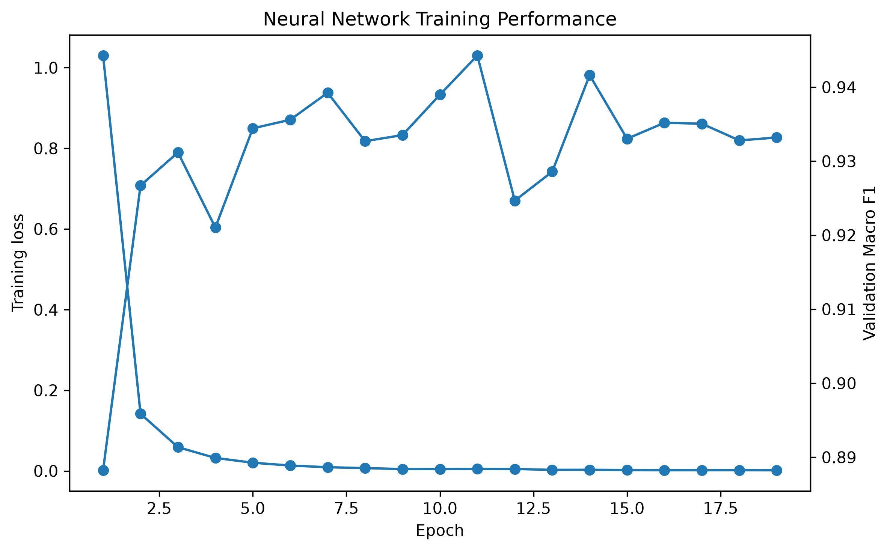
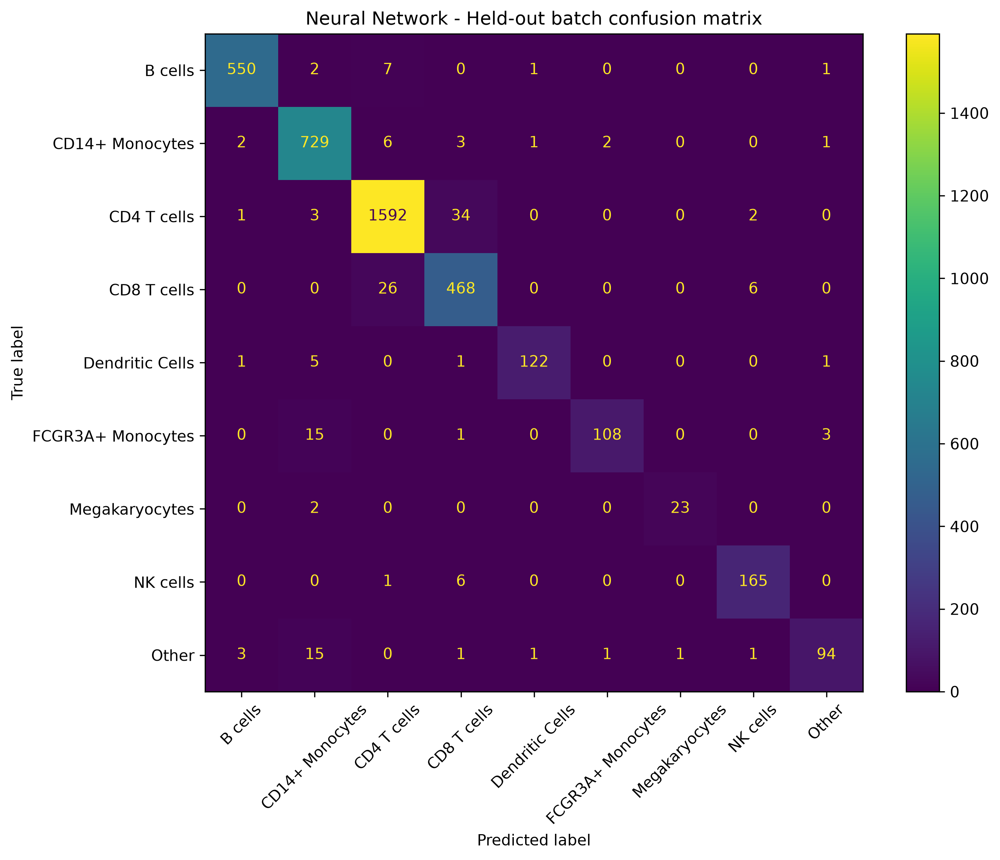
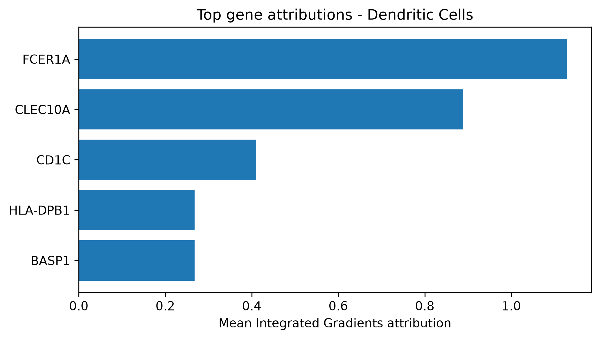

# Interpretable Deep Learning for Single-Cell RNA-seq Classification

An independent machine-learning project investigating cell-type classification
and model interpretability using single-cell RNA sequencing data.

The project compares a classical Logistic Regression baseline with a feed-forward
neural network implemented in PyTorch. Generalisation is evaluated across
experimental batches, and Integrated Gradients is used to investigate which
gene-expression features contribute to neural-network predictions.

## Research questions

1. Can cell types be classified accurately from single-cell RNA-seq expression data?
2. How does a neural network compare with a classical linear baseline?
3. Do the models generalise to a held-out experimental batch?
4. Do neural-network attributions identify biologically meaningful gene-level patterns?

## Dataset

The analysis uses a PBMC single-cell RNA-seq dataset loaded through `scvi-tools`.

- 11,990 cells
- 3,346 initial gene features
- 9 cell-type labels
- 2 experimental batches

Batch 0 was used for model development and was split into training and validation
sets. Batch 1 was kept completely separate for final evaluation.

After filtering, normalisation and log transformation, the 1,000 most highly
variable genes were selected using the training set only.

### Data source

The dataset was loaded using `scvi.data.pbmc_dataset()` from the
`scvi-tools` package. The dataset is based on the 10x Genomics PBMC 8k
and PBMC 4k datasets and includes batch information and pre-assigned
cell-type labels.

The raw data are downloaded automatically by `scvi-tools` and are not stored
in this repository.

## Experimental design

To reduce information leakage:

- the train/validation split was created using batch 0;
- batch 1 was reserved as the held-out test set;
- gene selection was performed using training data only;
- feature standardisation parameters were learned from training data only;
- model selection and early stopping used validation performance rather than
  held-out test performance.

## Models

### Logistic Regression

A class-weighted Logistic Regression model was used as a classical machine-learning
baseline.

### Neural network

A feed-forward neural network was implemented in PyTorch:

- 1,000 input gene features
- hidden layers of 256 and 64 units
- ReLU activation
- dropout regularisation
- class-weighted cross-entropy loss
- AdamW optimisation
- early stopping based on validation macro-F1

## Results

| Model | Validation Macro F1 | Held-out Accuracy | Held-out Macro F1 |
|---|---:|---:|---:|
| Logistic Regression | 0.9182 | 0.9618 | 0.9391 |
| Neural Network | 0.9443 | 0.9608 | 0.9409 |

Both models generalised strongly to the held-out experimental batch.

Logistic Regression achieved marginally higher overall accuracy, while the
neural network achieved marginally higher macro-F1. The very small difference
between the models shows that the simpler linear baseline already captured much
of the cell-type-associated signal in the selected gene-expression features.

Although the neural network achieved a substantially higher validation
macro-F1, this advantage did not translate into a meaningful improvement on
the held-out batch.

The neural network reached its best validation macro-F1 score of 0.9443 at
epoch 11. Training loss continued to decrease after validation performance had
peaked, highlighting the importance of early stopping.

### Key model results





## Model interpretation

Integrated Gradients was applied to correctly classified cells from the held-out
batch to investigate gene-level contributions to neural-network predictions.

Biologically plausible attribution patterns were observed across several cell
populations, including:

- **B cells:** CD79A, CD79B, BANK1, CD19
- **CD8 T cells:** GZMK, NKG7, CST7, CTSW, GZMH, CD8A
- **Dendritic cells:** FCER1A, CLEC10A, CD1C
- **FCGR3A+ monocytes:** CSF1R, HMOX1, C5AR1, HCK, MAFB
- **NK cells:** KLRF1, IL2RB, PRF1, GZMB
- **Megakaryocytes:** TUBB1, PPBP, PF4, GP9

The CD14+ monocyte and CD4 T-cell attribution profiles contained several
ribosomal or less cell-type-specific features, illustrating that attribution
patterns were not equally specific for all classes.

The heterogeneous `Other` category included genes such as LILRA4, IL3RA,
SPIB, DNASE1L3 and GZMB, suggesting that some cells within this group may have
a plasmacytoid-dendritic-cell-like expression profile.

Integrated Gradients attributions describe contributions to model predictions.
They should not be interpreted as differential gene expression, causal
relationships or definitive biological markers.
### Example Integrated Gradients attribution



## Limitations

- The analysis uses one PBMC dataset containing two experimental batches.
- Generalisation to independent datasets, laboratories or sequencing protocols
  was not evaluated.
- The neural-network architecture was deliberately simple and extensive
  hyperparameter optimisation was not performed.
- Cell-type labels were pre-assigned and therefore depend on the quality and
  biological resolution of the original annotations.
- Integrated Gradients results depend on both the trained model and the chosen
  attribution baseline.

## Tools

Python, PyTorch, Scanpy, scvi-tools, scikit-learn, Captum, pandas, NumPy and
Matplotlib.

## Running the project

Install the required Python dependencies:

```bash
pip install -r requirements.txt
```

Start JupyterLab:

```bash
jupyter lab
```

Open the notebook in the `notebooks/` directory and run all cells from top to
bottom.

The PBMC dataset is downloaded automatically by `scvi-tools`, so the raw data
do not need to be included in the repository.

## Repository structure

```text
single-cell-interpretable-ml/
├── notebooks/
│   └── interpretable_single_cell_classification.ipynb
├── figures/
│   ├── ig_dendritic_cells.png
│   ├── nn_heldout_confusion_matrix.png
│   └── nn_training_performance.png
├── README.md
├── requirements.txt
└── .gitignore